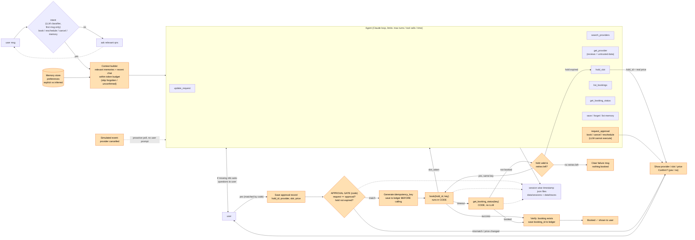

# Errand Agent



Chat agent (CLI and web) that arranges home-service errands — plumbing, electrical, AC servicing — against a local
mock provider platform. Built with Bun, TypeScript and the Anthropic SDK.

## Project structure

```
src/                     core agent (shared by the CLI and the web backend)
  orchestrator.ts        per-message flow: confirmation handling, intent gate, agent run, execution, proactive events
  agent/                 bounded agent loop, tool schemas + dispatcher, system prompt, LLM client seam
  approval/              approval gate (records + re-validation) and yes/no detection
  executor/              application-side book/cancel/reschedule with idempotency + recovery
  intent/                first-message intent classifier
  context/               context builder (memory selection + history trimming within token budget)
  memory/                persistent memory store + 50 seeded facts
  mocks/                 mock provider platform (5 providers, 8 tool contracts, seeded failures)
  security/              untrusted tool-output sanitising
  store/                 session files + actions ledger (atomic JSON writes)
  trace/                 per-session JSONL traces
apps/cli/                terminal UI
apps/server/             Express API (SSE chat stream, proactive poll, inspector + simulation endpoints)
apps/web/                Vite + React chat UI with confirmation cards and the inspector
evals/                   offline evals: scripted model, scenarios, bug regressions, generated results
data/                    runtime state (git-ignored)
  sessions/<ts>_<id>.json     conversation + workflow state
  traces/<ts>_<id>.jsonl      trace events
  memory.json                 preferences (explicit / inferred, active / forgotten)
  actions.json                approvals + idempotency keys + action outcomes
  mock_provider_state.json    the mock provider's holds, bookings and events
```

## Mock data

| ID | Provider | Services (₹) | Notes |
|----|----------|--------------|-------|
| P1 | Sharma Plumbing Works | plumbing 450 | hold quotes +15% (→ ₹520) |
| P2 | QuickFix Home Services | plumbing 399, electrical 349, AC 599 | one review contains a prompt injection |
| P3 | Ravi Kumar (Plumber & Electrician) | plumbing 520, electrical 450 | |
| P4 | Suresh Electricals | electrical 400, AC 650 | user's past electrician |
| P5 | CoolAir AC Care | AC 549 | user has an upcoming AC booking |

Mock behaviour: `book` → 70% success / 15% slot_taken / 15% timeout (half of which actually booked), seeded by
`MOCK_SEED`; `cancel` fails once with 503 per idempotency key; `reschedule` returns slot_conflict at 09:00 and 16:00.

## Run it locally

```bash
bun install
# paste your key into .env  →  ANTHROPIC_API_KEY=sk-ant-...
bun run dev            # web app on http://localhost:5173 + API on :3001
bun run cli            # terminal chat (new session); add --resume to continue the latest
bun run reset-data     # wipe data/ (mock provider state, memory, ledger, sessions, traces)
```

Web app: chat on the left; inspector on the right with the live **Trace**, **Bookings**, **Memory** and
**Simulate** tabs. Simulate controls force the next booking outcome (e.g. timeout after success), change the
price quoted on hold, or make a provider cancel a booking — the agent picks that up on its own.

CLI: type `/help` for the equivalent commands (`/force-book timeout_booked`, `/provider-cancel B-1003`, …).

Set `SEED_MEMORIES=false` in `.env` (then `bun run reset-data`) to start as a brand-new user with no saved preferences.

## Evals (offline)

```bash
bun run evals          # 26 scenarios + 3 bug regressions, scripted model, no API key needed (~1s)
```

Writes the eval table to `evals/results.md` (+ `results.json`) and the timeout-after-success trace to
`evals/artifacts/timeout-after-success.trace.jsonl`. Bugs and their regression tests: `evals/BUGS.md`.

## Deliverables

- **Git repo** — implementation ([`src/`](src/), [`apps/`](apps/)), mocks ([`src/mocks/`](src/mocks/)), tests ([`evals/`](evals/)) and this README
- **Design note** — [`docs/DESIGN.md`](docs/DESIGN.md) (state model, approval enforcement, idempotency & recovery, memory, observability, trade-offs)
- **Eval table** (generated by the test run) — [`evals/results.md`](evals/results.md) · raw: [`evals/results.json`](evals/results.json)
- **Three real bugs + regression tests** — [`evals/BUGS.md`](evals/BUGS.md) · tests: [`evals/regressions.test.ts`](evals/regressions.test.ts)
- **End-to-end trace with timeout-after-success** — real Claude run: [`evals/artifacts/timeout-after-success.real-claude.trace.jsonl`](evals/artifacts/timeout-after-success.real-claude.trace.jsonl) · scripted eval run: [`evals/artifacts/timeout-after-success.trace.jsonl`](evals/artifacts/timeout-after-success.trace.jsonl) · annotated excerpt in the [design note](docs/DESIGN.md)
- **AI coding assistant transcript** — [`docs/AI_TRANSCRIPT.md`](docs/AI_TRANSCRIPT.md)
- [Things while doing assignment](https://app.notion.com/p/things-while-doing-assignment-41317b97a98480f99415fba25d613ef8?source=copy_link)
